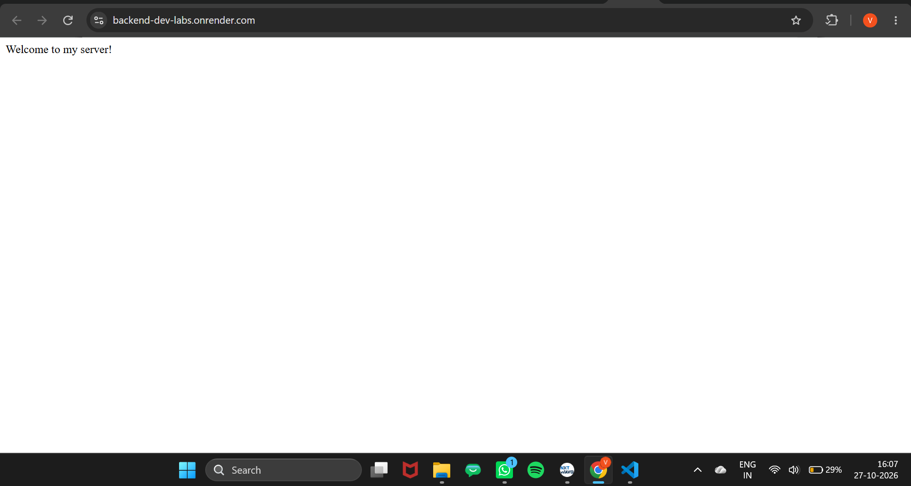
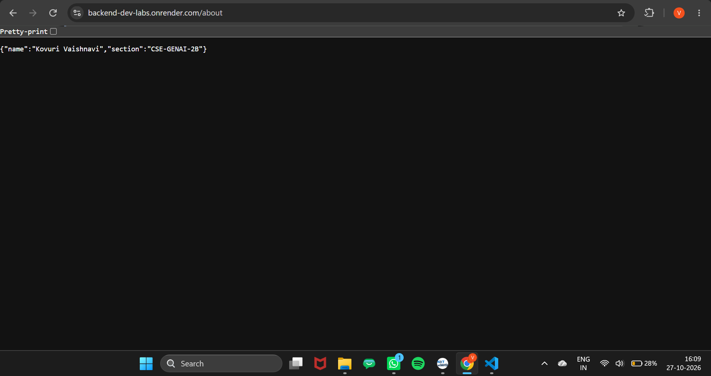
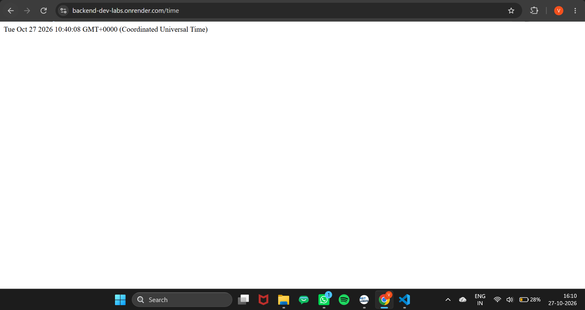
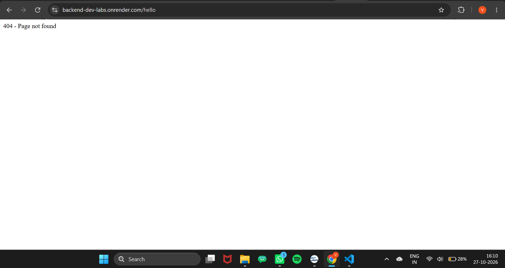

# Lab 1: Node.js and Express Server

## Student Details

- **Name:** KOVURI VAISHNAVI
- **Registration Number:** 252U1R9078
- **Section:** CSE GEN-AI 2B
- **Course:** Backend Development Fundamentals

## Live Link

https://backend-dev-labs.onrender.com/

## Objective

To understand the fundamentals of Node.js and Express.js by creating a web server, defining routes, handling HTTP requests and responses, and returning appropriate HTTP status codes.

## Technologies Used

- Node.js
- Express.js
- JavaScript
- npm (Node Package Manager)

## Project Structure

```text
lab-01/
├── server.js
├── package.json
├── package-lock.json
├── .gitignore
├── README.md
└── screenshots/
    ├── home.png
    ├── about.png
    ├── time.png
    └── not-found.png
```

## Installation and Setup

### Prerequisites

- Node.js and npm installed on your system.
- A code editor such as Visual Studio Code.

### Steps to Run

1. Clone the repository:

   ```bash
   git clone https://github.com/vaishnavikovuri/BACKEND-DEVELOPMENT-FUNDAMENTALS-LABS.git
   ```

2. Navigate to the lab-01 folder

3. Install the project dependencies:

   ```bash
   npm install
   ```

4. Start the server:

   ```bash
   node server.js
   ```

5. Open your browser and visit `http://localhost:3000/`.

## API Endpoints

| HTTP Method | Endpoint | Description | Status Code |
|---|---|---|---|
| GET | `/` | Displays a welcome message. | 200 |
| GET | `/about` | Returns the student's name and section in JSON format. | 200 |
| GET | `/time` | Returns the current date and time. | 200 |
| GET | `/hello` | Returns a 404 message for an unknown path. | 404 |

## Screenshots

### 1. Home Route



### 2. About Route



### 3. Time Route



### 4. 404 Error Route



## Concepts Learned

- Creating a Node.js project using `npm init -y`.
- Understanding `package.json` and `node_modules`.
- Installing Express.js using npm.
- Creating an HTTP server using Node.js.
- Creating an Express application using `express()`.
- Handling GET requests using `app.get()`.
- Understanding request (`req`) and response (`res`) objects.
- Returning JSON responses using `res.json()`.
- Generating the current date and time using `new Date()`.
- Returning appropriate HTTP status codes, including 200 and 404.

## Problems Faced and Solutions

- **Problem:** Understanding the difference between Node.js and Express.js.  
  **Solution:** Learned that Node.js provides the runtime environment, while Express.js simplifies web server development.

- **Problem:** Handling different URL paths.  
  **Solution:** Used Express route handlers to respond to requests for `/`, `/about`, and `/time`.

- **Problem:** Handling unknown routes.  
  **Solution:** Added a final middleware handler that returns a 404 status code for unmatched paths.

## Git Ignore

The `.gitignore` file contains:

```text
node_modules/
.env
```

The `node_modules` folder and `.env` file are excluded from version control.

## Conclusion

Successfully created a web server using Node.js and Express.js, implemented the required GET endpoints, tested the responses in a browser, and handled unknown routes using the HTTP 404 status code.
